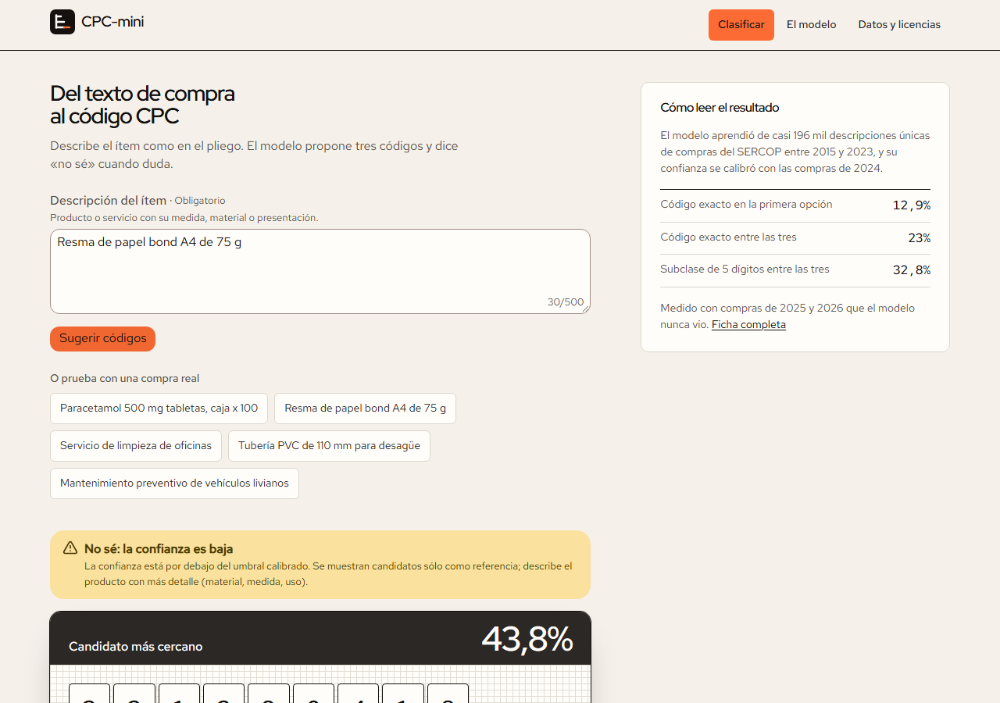
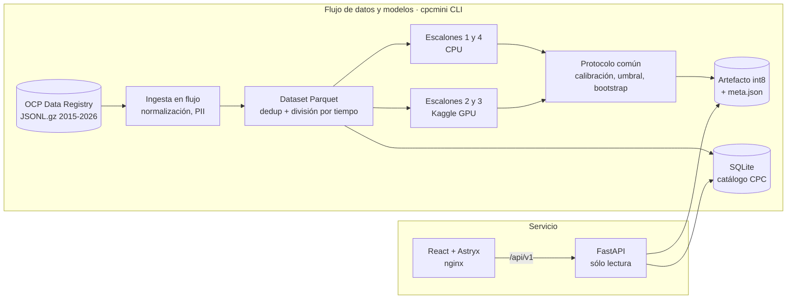
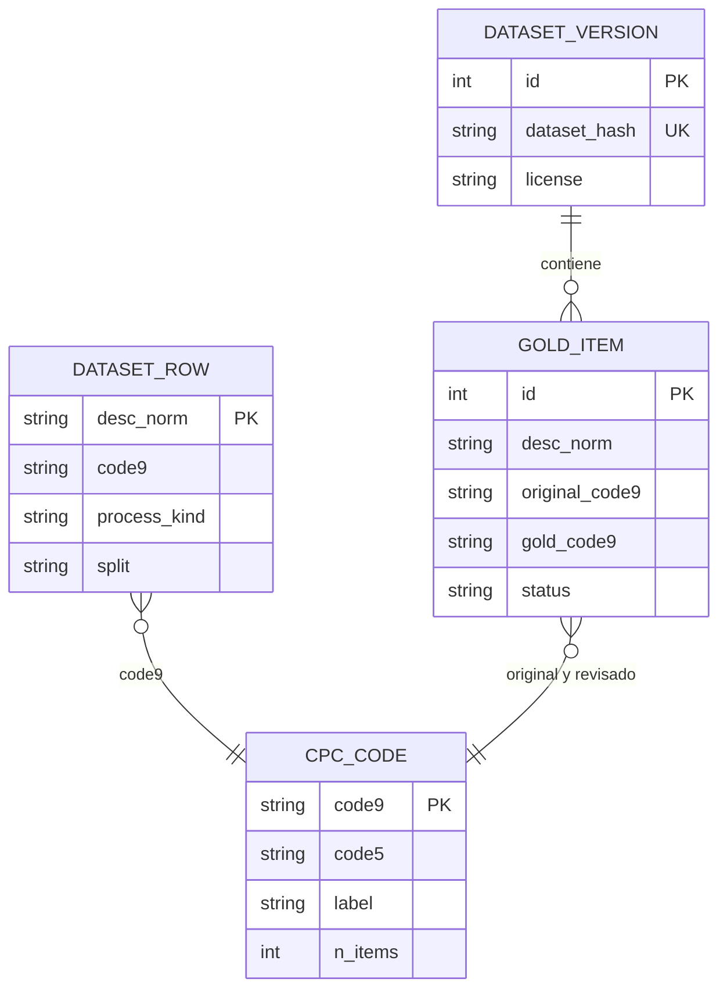

# CPC-mini

Un clasificador propio, entrenado con datos abiertos del SERCOP, que convierte la descripción libre de
una compra pública de Ecuador en sus tres códigos CPC más probables, dice «no sé» cuando duda y corre
en una laptop sin GPU.

[](https://github.com/DiegoFranciscoG/cpc-mini/actions/workflows/ci.yml)


**Demo:** sin despliegue público por decisión del proyecto; se levanta en local con
`docker compose up --build` (no requiere usuario ni contraseña).



## Problema que resuelve

Para comparar precios en compras públicas hay que saber que dos compras son del mismo producto. Cada
ítem lleva un código del Clasificador Central de Productos (CPC), pero la descripción es texto libre y
el código lo elige cada entidad, a veces mal. CPC-mini sugiere el código al escribir la descripción,
ayuda a detectar ítems mal clasificados y deja medido, con honestidad, cuánto se puede automatizar.

## Funcionalidades

- Tres códigos de 9 dígitos con su confianza calibrada, desglosados en grupo, subclase CPC de 5
  dígitos y código SERCOP.
- Abstención: «no sé» cuando la confianza no alcanza el umbral calibrado, o cuando la descripción no
  dice nada («ver pliegos»).
- Ficha del modelo en la web con métricas e intervalos servidos por la propia API.
- Escalera de cuatro modelos medidos con el mismo protocolo; la línea base se entrena en CPU.
- Dataset reproducible desde los datos públicos con un solo comando y hash de versión.
- Conjunto de oro de 300 ítems con herramienta de revisión en terminal.
- Aviso legal, privacidad (LOPDP), cookies (no hay) y atribución de datos; SEO y accesibilidad.

## Arquitectura



## Stack y por qué

| Capa | Tecnología | Motivo |
|---|---|---|
| Datos | Python 3.13, uv, Polars | Lectura en flujo de 1,1 GB de OCDS y agregaciones rápidas; `uv.lock` reproducible |
| Modelos | scikit-learn (TF-IDF, SGD, LinearSVC) | Línea base fuerte que entrena en minutos en CPU; el piso que un modelo grande debe superar |
| GPU (pendiente) | Transformers, PEFT, Unsloth, mmBERT-small, Qwen3-0.6B | Codificador multilingüe y generativo pequeño con salida restringida al catálogo |
| API | FastAPI, Pydantic, SQLAlchemy 2, Alembic | Validación tipada, OpenAPI automático, migraciones versionadas |
| Web | React 19, Vite 8, TypeScript 7, Astryx Design System | Componentes accesibles con tema propio y bundle pequeño |
| Pruebas | pytest, Vitest, Testing Library, Playwright | Unitarias, integración y flujo crítico en escritorio y móvil |
| DevOps | Docker multi-stage, GitHub Actions, gitleaks | Imágenes sin root y CI con escaneo de secretos |

## Resultados

Prueba con compras de 2025 y 2026 que ningún modelo vio (ni casi idénticas). Intervalos del 95 % por
bootstrap. Ganador elegido en **validación** (2024). Informe completo en
[reports/resultados.md](reports/resultados.md).

| Escalón | Top-1 9 díg. | Top-3 9 díg. | Top-1 5 díg. | Top-3 5 díg. | Latencia p50 | Tamaño |
|---|---|---|---|---|---|---|
| 1. TF-IDF + regresión logística jerárquica | 12,5 % | 23,0 % | 20,0 % | 36,6 % | 90 ms | 409 MB |
| **1. TF-IDF + SVM lineal jerárquico (en servicio, int8)** | **12,9 %** | **23,0 %** | **19,3 %** | **32,8 %** | **8,8 ms** | **42 MB** |
| 4. Vecinos TF-IDF + voto ponderado | 13,2 % | 23,6 % | 18,6 % | 35,2 % | 6,4 ms | 60 MB |
| 2. mmBERT-small jerárquico | pendiente de GPU | | | | | |
| 3. Qwen3-0.6B + LoRA restringido | pendiente de GPU | | | | | |

Lo que muestran los datos, sin maquillaje:

- **Las etiquetas limitan más que el modelo.** En procesos de un solo ítem el SVM acierta el código
  exacto 26 % de las veces y lo tiene entre los tres 40 %; en rubros de obra que heredan el código de
  la obra completa cae a 3 %, porque esa etiqueta no se deduce del texto.
- **El error dominante es bien frente a servicio:** hormigón premezclado (37510) contra servicios con
  hormigón (54540), pintura (35110) contra servicios de pintura (54730).
- **Ninguna confianza alcanza 90 % de exactitud** en descripciones nuevas, así que el modelo responde
  «no sé» casi siempre y muestra candidatos como referencia.
- Los tres modelos de CPU quedan a menos de un punto entre sí: más complejidad no compra exactitud con
  estas etiquetas. Si mmBERT o Qwen3 no superan esta línea base, también se publicará.

## Modelo de datos



Detalle de tablas, reglas y fuentes en [docs/modelo-datos.md](docs/modelo-datos.md); investigación y
cobertura medida en [docs/investigacion.md](docs/investigacion.md) y
[docs/verificacion.md](docs/verificacion.md).

## Ejecutar en local

Con Docker (modelo de demostración entrenado dentro de la imagen con la muestra pública versionada):

```bash
cp .env.example .env
docker compose up --build
```

Abre http://localhost:8080 (la API responde detrás del mismo proxy, por ejemplo
http://localhost:8080/api/v1/health). La documentación interactiva OpenAPI está en
http://127.0.0.1:8000/docs cuando la API corre sin Docker.

Sin Docker, con los datos completos (1,1 GB de descarga y unos 30 minutos de entrenamiento en CPU):

```bash
uv sync
uv run cpcmini download
uv run cpcmini rebuild --models tfidf_svm,tfidf_knn,tfidf_logreg --workers 4
uv run cpcmini predecir "Resma de papel bond A4 de 75 g"
```

API y web en modo desarrollo:

```bash
export CPCMINI_DATABASE_URL=sqlite:///data/cpcmini.db CPCMINI_MODEL_DIR=artifacts/serving CPCMINI_CORS_ALLOWED_ORIGINS=http://127.0.0.1:5173
uv run cpcmini db upgrade && uv run cpcmini db seed
uv run cpcmini serve
```

```bash
cd frontend && npm ci && npm run dev
```

## Variables de entorno

| Variable | Descripción | Obligatoria |
|---|---|---|
| `CPCMINI_DATABASE_URL` | URL SQLAlchemy de la base SQLite con el catálogo | Sí |
| `CPCMINI_MODEL_DIR` | Carpeta del modelo empaquetado (`cpcmini package`) | Sí |
| `CPCMINI_CORS_ALLOWED_ORIGINS` | Orígenes permitidos, separados por coma; se rechaza `*` | Sí |
| `CPCMINI_RATE_LIMIT_PER_MINUTE` | Consultas por minuto y cliente (60 por defecto) | No |
| `CPCMINI_DOCS_ENABLED` | Publica `/docs` y `/openapi.json` | No |
| `CPCMINI_TRUST_PROXY_HEADERS` | Toma la IP de `X-Real-IP` (sólo detrás del nginx propio) | No |
| `WEB_PORT` | Puerto local de la web en `docker compose` | No |
| `HF_TOKEN` | Sólo para publicar en Hugging Face; la app no lo usa | No |

## API

OpenAPI en `/docs`. Colección de ejemplos en [docs/api.http](docs/api.http).

| Método | Ruta | Descripción |
|---|---|---|
| GET | `/api/v1/health` | Estado, modelo cargado y códigos en el catálogo |
| GET | `/api/v1/model` | Métricas con intervalos, umbral, usos y atribución |
| POST | `/api/v1/predictions` | Tres candidatos para una descripción, o «no sé» |
| POST | `/api/v1/predictions/batch` | Hasta 50 descripciones |
| GET | `/api/v1/codes/{code9}` | Un código del catálogo |
| GET | `/api/v1/codes?q=` | Búsqueda por texto o prefijo |

## Pruebas y cobertura

```bash
uv run pytest --cov             # 137 pruebas, cobertura 95,9 % (mínimo exigido 70 %)
cd frontend && npm test         # 17 pruebas, cobertura 96 %
cd frontend && npx playwright test   # flujo crítico en escritorio y móvil (necesita la API)
```

| Prueba | Qué verifica | Dónde |
|---|---|---|
| T-01 | Conteos por año cuadran con la fuente descontando exclusiones | `tests/unit/test_dataset_rules.py` |
| T-02 | Ninguna descripción (ni su firma) en dos divisiones | `tests/unit/test_dataset_rules.py` |
| T-03 | División por tiempo respetada | `tests/unit/test_dataset_rules.py` |
| T-04 | Sin cédulas, RUC, teléfonos ni correos en lo publicado | `test_pii.py`, `test_dataset_rules.py`, `test_sample_download.py` |
| T-05 | El generativo sólo devuelve códigos del catálogo o «no sé» | `tests/unit/test_constrained.py` |
| T-06 | Misma semilla y datos, mismas métricas | `tests/integration/test_pipeline.py` |
| T-07 | int8 pierde menos de 2 puntos | `test_pipeline.py`, `test_models.py` (completo: −0,01 pts) |
| T-08 | El umbral alcanza la exactitud objetivo en validación | `test_metrics_calibration.py`, `test_pipeline.py` |
| T-09 | Atribución y licencia en dataset card, model card, API y web | `test_api.py`, `frontend/src/App.test.tsx` |
| T-10 | Menos de 200 ms por ítem en CPU | `test_pipeline.py` (completo: 13,5 ms p95) |
| T-11 | Normalización de tildes, unidades, abreviaturas y HTML | `tests/unit/test_normalize.py` |
| T-12 | Reconstrucción completa desde cero en carpeta vacía | `test_pipeline.py` y job `e2e` de CI |

## Despliegue

No hay despliegue público. Hugging Face Spaces con Gradio o Docker exige plan pago para cuentas
personales (verificado el 12-nov-2026). Los comandos para publicar dataset y modelo están en
[docs/publicar-hugging-face.md](docs/publicar-hugging-face.md) y no se ejecutaron.

## Seguridad aplicada

- API de sólo lectura sin almacenar ni registrar lo que escribe el usuario; la IP vive en memoria un
  minuto para el límite de consultas.
- Configuración crítica obligatoria (la API no arranca sin ella) y CORS con orígenes explícitos.
- Validación Pydantic con campos extra prohibidos, límites de longitud y de tamaño de cuerpo.
- Cabeceras CSP, `nosniff`, `DENY`, `Referrer-Policy`, `Permissions-Policy`; errores sin trazas.
- SQL parametrizado; comodines de `LIKE` escapados.
- Contenedores multi-stage, versiones fijas, usuario sin privilegios, sistema de archivos de sólo
  lectura, `no-new-privileges` y sin capacidades.
- Tipografías servidas por el propio sitio: el navegador no contacta a terceros.
- gitleaks en CI sobre todo el historial; Dependabot para pip/uv, npm, Docker y Actions.

## Decisiones técnicas

- **División por tiempo y deduplicación entre divisiones** en lugar de partición aleatoria: una
  partición aleatoria da 35 % de top-1 porque mide memoria, no generalización.
- **Jerarquía 3 → 5 → 9 con modelos locales por rama** en vez de un clasificador plano de 9 000
  clases: el plano necesitaba varios GB de pesos; los locales usan sólo las columnas de su rama.
- **Regresión logística por SGD** en lugar de lbfgs: lbfgs no terminó en 9 minutos el nodo raíz con
  30 000 filas; SGD entrena el modelo completo (147 532 descripciones) en 5 minutos.
- **Ganador elegido en validación**, no en prueba, aunque en prueba el kNN quede 0,3 puntos arriba.
- **int8 en disco, desempaquetado al cargar**: 42 MB en lugar de 237 MB sin pagar latencia por
  consulta (desempaquetar en cada consulta llevaba la p95 a 392 ms).
- **Restaurar el 0 de la sección 0 del CPC** usando `additionalClassifications`: sin eso los
  alimentos caen en ramas equivocadas.
- **No recortar el alcance a «procesos limpios»:** el experimento mostró que el ruido es transversal;
  se reporta por tipo de proceso.
- **React + Astryx en vez de Gradio** para la demo: Gradio en Spaces ya no es gratuito y la web
  necesitaba páginas legales, SEO y accesibilidad.

## Roadmap

- [ ] Ejecutar los escalones 2 y 3 en Kaggle y publicar sus métricas, ganen o no.
- [ ] Revisar a mano el conjunto de oro (300 ítems) y reportar la exactitud sobre él.
- [ ] Variante densa del escalón 4 con `multilingual-e5-small`.
- [ ] Usar el contexto del proceso (título, categoría) como señal opcional para los rubros de obra.

## Fuentes de datos y licencias

- Datos: Servicio Nacional de Contratación Pública (SERCOP), publicados en formato OCDS por el
  [OCP Data Registry](https://data.open-contracting.org/en/publication/110) de Open Contracting
  Partnership — [CC BY 3.0 Ecuador](https://creativecommons.org/licenses/by/3.0/ec/). Transformaciones
  en [docs/dataset-card.md](docs/dataset-card.md). No implica respaldo del SERCOP ni de OCP.
- Modelos base: [mmBERT-small](https://huggingface.co/jhu-clsp/mmBERT-small) (MIT) y
  [Qwen3-0.6B-Base](https://huggingface.co/Qwen/Qwen3-0.6B-Base) (Apache-2.0).
- Interfaz: [Astryx Design System](https://github.com/meta/astryx) (MIT); tipografías Red Hat
  (SIL OFL 1.1).
- Código de este repositorio: MIT.

## Autor

**Diego Francisco Granda Zhingre** · [GitHub](https://github.com/DiegoFranciscoG)
