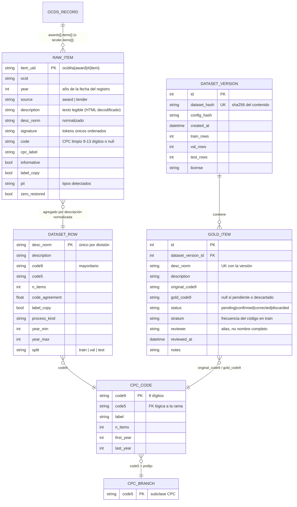

# Modelo de datos

El proyecto tiene dos capas de datos:

1. **Archivos analíticos (Parquet, en `data/`, no versionados):** el dataset de entrenamiento y su
   catálogo, reconstruibles con `cpcmini rebuild`.
2. **Base relacional (SQLite + SQLAlchemy 2 + migraciones Alembic en `migrations/`):** lo que la API
   y la herramienta del conjunto de oro necesitan consultar y modificar con integridad.

Las reglas citan la fuente numerada en [investigacion.md](investigacion.md) o el hallazgo de
[verificacion.md](verificacion.md).

## Tablas relacionales (migración `0001_initial`)

| Tabla | Campo | Tipo | Restricción | Regla / fuente |
|---|---|---|---|---|
| `cpc_code` | `code9` | VARCHAR(9) | PK, `length = 9`, sólo dígitos | Nivel 9 del SERCOP [3] |
| `cpc_code` | `code5` | VARCHAR(5) | NOT NULL, índice, `= substr(code9,1,5)` | Subclase CPC de registro de proveedores [3] |
| `cpc_code` | `label` | VARCHAR(300) | NOT NULL | Etiqueta más frecuente de `classification.description`, prefiriendo ítems con código exacto de 9 dígitos [1][4] |
| `cpc_code` | `n_items`, `first_year`, `last_year` | INTEGER | `n_items >= 0` | Conteos de ítems usables |
| `dataset_version` | `dataset_hash` | VARCHAR(64) | UNIQUE | SHA-256 de (división, descripción, código) ordenados: reproducibilidad (T-06) |
| `dataset_version` | `config_hash` | VARCHAR(16) | NOT NULL | Hash de `configs/data.yaml` validado |
| `dataset_version` | `license` | VARCHAR(40) | NOT NULL | CC BY 3.0 EC [2] |
| `gold_item` | `desc_norm` | VARCHAR(300) | UNIQUE con `dataset_version_id` | Un ítem por descripción y versión |
| `gold_item` | `status` | VARCHAR(12) | CHECK en 4 valores | Flujo de revisión manual |
| `gold_item` | `gold_code9` | VARCHAR(9) | obligatorio si `confirmed`/`corrected` | Medida honesta frente a etiquetas ruidosas |
| `gold_item` | `reviewer` | VARCHAR(40) | NULL | Alias (minimización, LOPDP [5]) |

## Reglas del dataset (Parquet)

| Regla | Valor | Fuente |
|---|---|---|
| Fuente de ítems | `awards[].items[]`; si el proceso no tiene, `tender.items[]` | Cobertura ~100 % de descripción y CPC en adjudicaciones [verificación c] |
| Limpieza del código | Sólo dígitos; restaurar el 0 inicial si `additionalClassifications` empieza con 0 y comparte los 4 dígitos siguientes; 9–13 dígitos | Hallazgo 1 [4] |
| Niveles | 5 y 9 dígitos por prefijo | [3] |
| Exclusiones | sin código · genérica (`configs/data.yaml: text.generic_patterns`) · datos personales | Hallazgos [verificación c], LOPDP [5], S-1 |
| División por tiempo | train ≤ 2023 · val 2024 · test 2025–2026 | Plan del proyecto |
| Deduplicación | una fila por `desc_norm` en cada división; se quita de val/test lo visto antes (exacto o por firma) | T-02 |
| Etiqueta | código de 9 dígitos mayoritario por descripción, desempate por código | Hallazgo 7 |
| Tope de entrenamiento | 400 descripciones por código (las más frecuentes) | Laptop de 16 GB, CPU |

## Datos ficticios y datos reales

- Las semillas de prueba (`tests/conftest.py`) son **ficticias**: descripciones inventadas, cédulas
  sintéticas generadas con el algoritmo de verificación.
- `sample_data/ocds/` contiene una muestra **minimizada** de datos públicos del SERCOP (sin partes,
  compradores ni proveedores, sin descripciones con patrones de datos personales), con atribución.
- No se guarda ninguna descripción escrita por usuarios de la demo.
